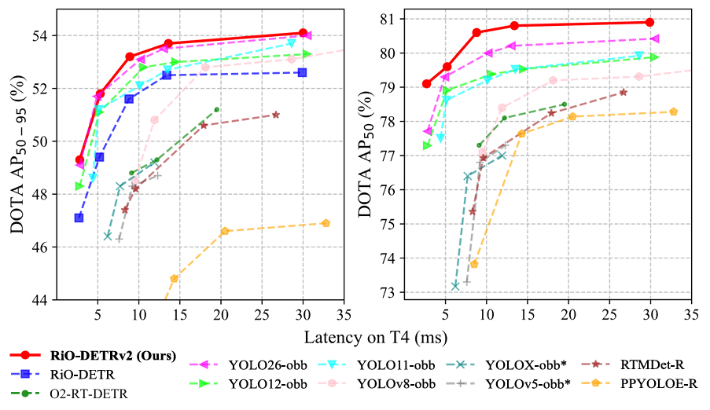

<h2 align="center">RiO-DETRv2: Geometry-Aware Uncertainty Modeling Meets Real-Time Oriented Object Detection Transformer</h2>

<p align="center">
  <a href="https://arxiv.org/abs/2610.29159"></a>
  <a href="https://pytorch.org/"></a>
  <a href="https://huggingface.co/RicePasteM/RiO-DETRv2"></a>
  <a href="LICENSE"></a>
</p>

<div align="center">
  Zhangchi Hu<sup>1</sup>,
  Zilong He<sup>1</sup>,
  Yifan Zhao<sup>1</sup>,
  Xiangyu Yu<sup>1</sup>,
  Jie Chen<sup>1</sup>,
  Peixi Wu<sup>1</sup>,
  Yansong Peng<sup>1</sup>,
  Hebei Li<sup>1,*</sup>,
  Xiaoyan Sun<sup>1,2</sup>
</div>

<p></p>

<div align="center">
<i>1. University of Science and Technology of China</i>
</div>

<div align="center">
<i>2. Institute of Artificial Intelligence, Hefei Comprehensive National Science Center</i>
</div>

<p></p>

<p align="center">
  <b>Corresponding author:</b>
  <a href="mailto:lihebei@mail.ustc.edu.cn">lihebei@mail.ustc.edu.cn</a>
</p>

<p align="center">
  <a href="#highlights">Highlights</a> &middot;
  <a href="#demo-bogota-airport">Demo</a> &middot;
  <a href="#model-zoo">Model Zoo</a> &middot;
  <a href="#getting-started">Getting Started</a> &middot;
  <a href="#usage">Usage</a> &middot;
  <a href="#deployment">Deployment</a>
</p>

**RiO-DETRv2 is a real-time, end-to-end oriented object detector that refines both object boundaries and orientation through learned distributions.**

<p align="center">
  
  <br>
  <em>DOTA-v1.0 accuracy versus inference latency on NVIDIA T4.</em>
</p>

## Highlights

- **Fine-grained object-aligned localization.** Four-side boundary distributions support progressive refinement in an object-aligned coordinate system.
- **Coarse-to-fine orientation refinement.** Each decoder layer predicts an angular residual around its current reference angle, with progressively finer refinement ranges.
- **Boundary-and-angle-aware confidence.** Boundary distribution concentration and angular entropy inform detection scores, with object shape providing context for orientation ambiguity.
- **A scalable real-time detector family.** N, S, M, L, and X configurations share the same oriented-detection framework, with ONNX export and TensorRT FP16 deployment utilities.

## Demo: Bogota Airport

We challenge **RiO-DETRv2** with high-resolution Jilin-1 satellite footage of Bogota Airport, Colombia. Under moving cloud cover and dense aircraft layouts, the model delivers well-aligned oriented detections across successive frames, showcasing its capability in dynamic satellite scenes.

<div align="center">

https://github.com/user-attachments/assets/c4136f3a-2a70-422b-9e06-5a299fc75925

</div>

RiO-DETRv2-X uses DOTA-1.0 pretrained weights and tiled inference. Video credit: [Paul Sed, "Jilin-1 Live streaming from space - Bogota, Colombia"](https://www.youtube.com/watch?v=a5BazZA8nvk).

## Model Zoo

Download pretrained EMA checkpoints and training logs from [Hugging Face](https://huggingface.co/RicePasteM/RiO-DETRv2).

Release metadata: [manifest](https://huggingface.co/RicePasteM/RiO-DETRv2/blob/main/manifest.json) · [SHA256 checksums](https://huggingface.co/RicePasteM/RiO-DETRv2/resolve/main/SHA256SUMS).

### DOTA-v1.0 Single-Scale

Results are evaluated on the DOTA-v1.0 test set by the official evaluation server, using 1024 x 1024 image patches and merged full-image predictions.

| Model | Params | mAP50-95 | AP50 | AP75 | Config | Weights | Logs |
| --- | ---: | ---: | ---: | ---: | --- | --- | --- |
| RiO-DETRv2-N | 4.3M | 49.20 | 79.10 | 50.94 | [yml](configs/rio-dota_1_ss/riov2_hgnetv2_n_dota_1.yml) | [pth](https://huggingface.co/RicePasteM/RiO-DETRv2/resolve/main/dota_1_ss/riov2_hgnetv2_n_dota_1_ss.pth?download=true) | [train](https://huggingface.co/RicePasteM/RiO-DETRv2/resolve/main/training_logs/dota_1_ss/riov2_hgnetv2_n_dota_1_ss.jsonl) · [console](https://huggingface.co/RicePasteM/RiO-DETRv2/resolve/main/training_logs/dota_1_ss/riov2_hgnetv2_n_dota_1_ss.log) · [eval](https://huggingface.co/RicePasteM/RiO-DETRv2/resolve/main/training_logs/dota_1_ss/eval/riov2_hgnetv2_n_dota_1_ss_eval.csv) |
| RiO-DETRv2-S | 8.9M | 51.82 | 79.56 | 56.36 | [yml](configs/rio-dota_1_ss/riov2_hgnetv2_s_dota_1.yml) | [pth](https://huggingface.co/RicePasteM/RiO-DETRv2/resolve/main/dota_1_ss/riov2_hgnetv2_s_dota_1_ss.pth?download=true) | [train](https://huggingface.co/RicePasteM/RiO-DETRv2/resolve/main/training_logs/dota_1_ss/riov2_hgnetv2_s_dota_1_ss.jsonl) · [console](https://huggingface.co/RicePasteM/RiO-DETRv2/resolve/main/training_logs/dota_1_ss/riov2_hgnetv2_s_dota_1_ss.log) · [eval](https://huggingface.co/RicePasteM/RiO-DETRv2/resolve/main/training_logs/dota_1_ss/eval/riov2_hgnetv2_s_dota_1_ss_eval.csv) |
| RiO-DETRv2-M | 19.5M | 53.20 | **81.20** | 57.30 | [yml](configs/rio-dota_1_ss/riov2_hgnetv2_m_dota_1.yml) | [pth](https://huggingface.co/RicePasteM/RiO-DETRv2/resolve/main/dota_1_ss/riov2_hgnetv2_m_dota_1_ss.pth?download=true) | [train](https://huggingface.co/RicePasteM/RiO-DETRv2/resolve/main/training_logs/dota_1_ss/riov2_hgnetv2_m_dota_1_ss.jsonl) · [console](https://huggingface.co/RicePasteM/RiO-DETRv2/resolve/main/training_logs/dota_1_ss/riov2_hgnetv2_m_dota_1_ss.log) · [eval](https://huggingface.co/RicePasteM/RiO-DETRv2/resolve/main/training_logs/dota_1_ss/eval/riov2_hgnetv2_m_dota_1_ss_eval.csv) |
| RiO-DETRv2-L | 28.6M | 53.63 | 80.77 | 58.69 | [yml](configs/rio-dota_1_ss/riov2_hgnetv2_l_dota_1.yml) | [pth](https://huggingface.co/RicePasteM/RiO-DETRv2/resolve/main/dota_1_ss/riov2_hgnetv2_l_dota_1_ss.pth?download=true) | [train](https://huggingface.co/RicePasteM/RiO-DETRv2/resolve/main/training_logs/dota_1_ss/riov2_hgnetv2_l_dota_1_ss.jsonl) · [console](https://huggingface.co/RicePasteM/RiO-DETRv2/resolve/main/training_logs/dota_1_ss/riov2_hgnetv2_l_dota_1_ss.log) · [eval](https://huggingface.co/RicePasteM/RiO-DETRv2/resolve/main/training_logs/dota_1_ss/eval/riov2_hgnetv2_l_dota_1_ss_eval.csv) |
| RiO-DETRv2-X | 64.6M | **54.13** | 80.99 | **59.44** | [yml](configs/rio-dota_1_ss/riov2_hgnetv2_x_dota_1.yml) | [pth](https://huggingface.co/RicePasteM/RiO-DETRv2/resolve/main/dota_1_ss/riov2_hgnetv2_x_dota_1_ss.pth?download=true) | [train](https://huggingface.co/RicePasteM/RiO-DETRv2/resolve/main/training_logs/dota_1_ss/riov2_hgnetv2_x_dota_1_ss.jsonl) · [console](https://huggingface.co/RicePasteM/RiO-DETRv2/resolve/main/training_logs/dota_1_ss/riov2_hgnetv2_x_dota_1_ss.log) · [eval](https://huggingface.co/RicePasteM/RiO-DETRv2/resolve/main/training_logs/dota_1_ss/eval/riov2_hgnetv2_x_dota_1_ss_eval.csv) |

Evaluation CSVs contain the original epoch-level official test results, including VOC mAP, AP50, AP75, COCO mAP50-95, and all 15 category AP values. CSV metrics are fractions in [0, 1]; epochs are zero-based and match the checkpoint filenames. Released checkpoint epochs: N 142, S 132, M 102, L 84, X 64.

### DIOR-R

Results use 800 x 800 inputs on the DIOR-R test split. AP is evaluated with geometric rotated-box IoU and VOC-style 11-point interpolation over the listed IoU thresholds.

| Model | Params | mAP50-95 | AP50 | AP75 | Config | Weights | Logs |
| --- | ---: | ---: | ---: | ---: | --- | --- | --- |
| RiO-DETRv2-N | 4.3M | 46.46 | 72.17 | 47.67 | [yml](configs/rio-diorr/riov2_hgnetv2_n_diorr.yml) | [pth](https://huggingface.co/RicePasteM/RiO-DETRv2/resolve/main/diorr/riov2_hgnetv2_n_diorr.pth?download=true) | [train](https://huggingface.co/RicePasteM/RiO-DETRv2/resolve/main/training_logs/diorr/riov2_hgnetv2_n_diorr.jsonl) · [console](https://huggingface.co/RicePasteM/RiO-DETRv2/resolve/main/training_logs/diorr/riov2_hgnetv2_n_diorr.log) |
| RiO-DETRv2-S | 8.9M | 49.95 | 75.11 | 51.27 | [yml](configs/rio-diorr/riov2_hgnetv2_s_diorr.yml) | [pth](https://huggingface.co/RicePasteM/RiO-DETRv2/resolve/main/diorr/riov2_hgnetv2_s_diorr.pth?download=true) | [train](https://huggingface.co/RicePasteM/RiO-DETRv2/resolve/main/training_logs/diorr/riov2_hgnetv2_s_diorr.jsonl) · [console](https://huggingface.co/RicePasteM/RiO-DETRv2/resolve/main/training_logs/diorr/riov2_hgnetv2_s_diorr.log) |
| RiO-DETRv2-M | 19.5M | 52.60 | 77.27 | 54.30 | [yml](configs/rio-diorr/riov2_hgnetv2_m_diorr.yml) | [pth](https://huggingface.co/RicePasteM/RiO-DETRv2/resolve/main/diorr/riov2_hgnetv2_m_diorr.pth?download=true) | [train](https://huggingface.co/RicePasteM/RiO-DETRv2/resolve/main/training_logs/diorr/riov2_hgnetv2_m_diorr.jsonl) · [console](https://huggingface.co/RicePasteM/RiO-DETRv2/resolve/main/training_logs/diorr/riov2_hgnetv2_m_diorr.log) |
| RiO-DETRv2-L | 28.6M | 52.88 | 77.53 | 54.41 | [yml](configs/rio-diorr/riov2_hgnetv2_l_diorr.yml) | [pth](https://huggingface.co/RicePasteM/RiO-DETRv2/resolve/main/diorr/riov2_hgnetv2_l_diorr.pth?download=true) | [train](https://huggingface.co/RicePasteM/RiO-DETRv2/resolve/main/training_logs/diorr/riov2_hgnetv2_l_diorr.jsonl) · [console](https://huggingface.co/RicePasteM/RiO-DETRv2/resolve/main/training_logs/diorr/riov2_hgnetv2_l_diorr.log) |
| RiO-DETRv2-X | 64.6M | **53.94** | **78.30** | **56.11** | [yml](configs/rio-diorr/riov2_hgnetv2_x_diorr.yml) | [pth](https://huggingface.co/RicePasteM/RiO-DETRv2/resolve/main/diorr/riov2_hgnetv2_x_diorr.pth?download=true) | [train](https://huggingface.co/RicePasteM/RiO-DETRv2/resolve/main/training_logs/diorr/riov2_hgnetv2_x_diorr.jsonl) · [console](https://huggingface.co/RicePasteM/RiO-DETRv2/resolve/main/training_logs/diorr/riov2_hgnetv2_x_diorr.log) |

<!-- ### AI-TOD-R

The AI-TOD-R models use 800 x 800 inputs and 900 object queries to target dense tiny-object detection. Results are evaluated on the configured test split with geometric rotated-box IoU and 101-point AP interpolation.

| Model | Params | mAP50-95 | AP50 | AP75 | Config | Weights | Logs |
| --- | ---: | ---: | ---: | ---: | --- | --- | --- |
| RiO-DETRv2-M | 19.5M | 18.98 | 55.53 | 7.39 | [yml](configs/rio-aitodr/riov2_hgnetv2_m_aitodr.yml) | [pth](https://huggingface.co/RicePasteM/RiO-DETRv2/resolve/main/aitodr/riov2_hgnetv2_m_aitodr.pth?download=true) | [train](https://huggingface.co/RicePasteM/RiO-DETRv2/resolve/main/training_logs/aitodr/riov2_hgnetv2_m_aitodr.jsonl) · [console](https://huggingface.co/RicePasteM/RiO-DETRv2/resolve/main/training_logs/aitodr/riov2_hgnetv2_m_aitodr.log) |
| RiO-DETRv2-X | 64.6M | **20.54** | **59.05** | **8.52** | [yml](configs/rio-aitodr/riov2_hgnetv2_x_aitodr_ap5095.yml) | [pth](https://huggingface.co/RicePasteM/RiO-DETRv2/resolve/main/aitodr/riov2_hgnetv2_x_aitodr.pth?download=true) | [train](https://huggingface.co/RicePasteM/RiO-DETRv2/resolve/main/training_logs/aitodr/riov2_hgnetv2_x_aitodr.jsonl) · [console](https://huggingface.co/RicePasteM/RiO-DETRv2/resolve/main/training_logs/aitodr/riov2_hgnetv2_x_aitodr.log) | -->

## Getting Started

### Installation

Create a Python 3.10 environment and install PyTorch with a matching CUDA runtime. For CUDA 12.1:

```bash
conda create -n rio-detr-v2 python=3.10 -y
conda activate rio-detr-v2

pip install torch==2.2.2 torchvision==0.17.2 \
  --index-url https://download.pytorch.org/whl/cu121
pip install "numpy<2" -r requirements.txt
```

Run the following commands from the repository root. HGNetv2 ImageNet-pretrained backbone weights are downloaded automatically and cached under `pretrain/hgnetv2/`.

### Download Pretrained Models

Download an individual checkpoint with the Hugging Face CLI:

```bash
pip install "huggingface_hub>=0.34,<1"
hf download RicePasteM/RiO-DETRv2 \
  diorr/riov2_hgnetv2_x_diorr.pth \
  --local-dir pretrained/riov2
```

Omit the filename to download the complete model collection, configurations, and training logs.

### Training with DINOv3

The training configurations use [DINOv3](https://github.com/facebookresearch/dinov3) as a feature teacher. Arrange its source and ViT-B/16 pretrained checkpoint as follows:

```text
third_party/
└── dinov3/
pretrain/
└── dinov3/
    └── dinov3_vitb16_pretrain_lvd1689m.pth
```

The teacher is used only during training. DINOv3 source and pretrained weights follow their respective licenses.

## Data Preparation

The default configurations use repository-relative dataset paths. Create symlinks under `datasets/` or edit the matching dataset YAML file for your installation.

### DOTA-v1.0

Prepare the original images and polygon annotations as 1024 x 1024 patches using the standard DOTA patch naming convention:

```text
datasets/dota-1.0/
├── single-scale/
│   ├── trainval/
│   │   ├── images/
│   │   └── annfiles/
│   └── test/
│       ├── images/
│       └── annfiles/
└── multi-scale/
    ├── trainval/
    │   ├── images/
    │   └── annfiles/
    └── test/
        ├── images/
        └── annfiles/
```

Each annotation file contains one polygon per line:

```text
x1 y1 x2 y2 x3 y3 x4 y4 class_name difficulty
```

For unlabeled test patches, provide an empty annotation file with the same image stem. Paths are configured in [single-scale](configs/dataset/dota_1_ss_detection_offline.yml) and [multi-scale](configs/dataset/dota_1_ms_detection_offline.yml) dataset definitions.

The offline evaluator merges patch predictions and generates a submission ZIP for official DOTA evaluation. [DOTA-Auto-Eval](https://github.com/RicePasteM/DOTA-Auto-Eval) provides a companion workflow for submission management.

### DIOR-R

```text
datasets/dior-r/
├── JPEGImages-trainval/
├── JPEGImages-test/
├── Annotations/
│   └── Oriented Bounding Boxes/
└── ImageSets/
    └── Main/
        ├── train.txt
        ├── val.txt
        └── test.txt
```

The detector trains on the combined train/validation split and evaluates on the test split. Paths are defined in [dior_detection.yml](configs/dataset/dior_detection.yml).

### AI-TOD-R

```text
datasets/ai-tod-r/
├── images/
│   ├── trainval/
│   └── test/
└── labels_dota/
    ├── trainval/
    └── test/
```

Use DOTA-format polygon annotations with the eight AI-TOD-R class names. The [dataset definition](configs/dataset/aitodr_detection.yml) specifies the trainval/test paths, evaluated image IDs, and 101-point evaluator.

### FAIR1M-2.0

Multi-scale training configurations are also provided for FAIR1M-2.0. Convert annotations to DOTA-format polygon text files and arrange the processed patches under:

```text
datasets/fair1m-2.0/
├── train/
│   ├── images/
│   └── annfiles/
└── validation/
    ├── images/
    └── annfiles/
```

## Usage

### Available Configurations

| Dataset | Scales | Configuration |
| --- | --- | --- |
| DIOR-R | N, S, M, L, X | `configs/rio-diorr/riov2_hgnetv2_{n,s,m,l,x}_diorr.yml` |
| DOTA-v1.0 SS | N, S, M, L, X | `configs/rio-dota_1_ss/riov2_hgnetv2_{n,s,m,l,x}_dota_1.yml` |
| DOTA-v1.0 MS | M, X | `configs/rio-dota_1_ms/riov2_hgnetv2_{m,x}_dota_1.yml` |
| FAIR1M-2.0 MS | M, X | `configs/rio-fair1m_ms/riov2_hgnetv2_{m,x}_fair_2.yml` |
| AI-TOD-R | M, X | `configs/rio-aitodr/riov2_hgnetv2_{m,x}_aitodr.yml` |

AI-TOD-R-X also provides [AP50-95 fine-tuning](configs/rio-aitodr/riov2_hgnetv2_x_aitodr_ap5095.yml), with AP50-95 checkpoint selection and a dedicated output directory. Use `-r` with a base X training checkpoint to continue training with this configuration.

### Training

Train RiO-DETRv2-X on DIOR-R with two GPUs:

```bash
CUDA_VISIBLE_DEVICES=0,1 torchrun \
  --nproc_per_node=2 --master_port=7001 \
  train.py \
  -c configs/rio-diorr/riov2_hgnetv2_x_diorr.yml \
  --use-amp --seed=0
```

Set `--nproc_per_node` to the number of visible GPUs. The configuration's `total_batch_size` is shared across all processes. Training checkpoints and logs are saved to `output_dir`; use `--output-dir` to select a different destination.

Resume a training run with its full training checkpoint:

```bash
CUDA_VISIBLE_DEVICES=0,1 torchrun \
  --nproc_per_node=2 --master_port=7001 \
  train.py \
  -c configs/rio-diorr/riov2_hgnetv2_x_diorr.yml \
  -r outputs/riov2_hgnetv2_x_diorr/last.pth \
  --use-amp --seed=0
```

### Evaluation

Evaluate a DIOR-R checkpoint and report AP50, AP75, and mAP50-95:

```bash
CUDA_VISIBLE_DEVICES=0,1 torchrun \
  --nproc_per_node=2 --master_port=7001 \
  train.py \
  -c configs/rio-diorr/riov2_hgnetv2_x_diorr.yml \
  -r /path/to/riov2_x_diorr.pth \
  --test-only --seed=0 \
  -u 'evaluator.iou_thrs=[0.50,0.55,0.60,0.65,0.70,0.75,0.80,0.85,0.90,0.95]'
```

Generate a DOTA-v1.0 single-scale submission with the two-GPU evaluation setup:

```bash
CUDA_VISIBLE_DEVICES=0,1 torchrun \
  --nproc_per_node=2 --master_port=7001 \
  train.py \
  -c configs/rio-dota_1_ss/riov2_hgnetv2_x_dota_1.yml \
  -r /path/to/riov2_x_dota_1_ss.pth \
  --test-only --seed=0
```

Merged submission archives are written under `<output_dir>/dota_results/`. Submit the ZIP to the official DOTA server for test-set metrics. DIOR-R and AI-TOD-R report local metrics from their labeled test splits.

## Deployment

The deployment tools support ONNX export, TensorRT engine construction, and GPU inference benchmarking.

Export a 1024 x 1024 DOTA model to ONNX:

```bash
pip install onnx onnxsim

python tools/deployment/export_onnx.py \
  -c configs/rio-dota_1_ss/riov2_hgnetv2_x_dota_1.yml \
  -r /path/to/riov2_x_dota_1_ss.pth
```

The ONNX file is saved next to the checkpoint. With TensorRT installed, build an FP16 engine and benchmark it:

```bash
python tools/deployment/export_engine.py \
  --onnx /path/to/riov2_x_dota_1_ss.onnx \
  --saveEngine /path/to/riov2_x_dota_1_ss_fp16.engine \
  --fp16

python tools/deployment/benchmark_tensorrt.py \
  --engine /path/to/riov2_x_dota_1_ss_fp16.engine \
  --warmup 100 --num-runs 1000
```

The benchmark uses GPU-resident buffers and CUDA events to measure TensorRT execution latency. Preprocessing, host/device transfers, and host-side postprocessing are outside this measurement. Add `--use-cuda-graph` for CUDA Graph benchmarking.

## License

RiO-DETRv2 is released under the [GNU Affero General Public License v3.0](LICENSE). Third-party code, foundation models, and pretrained weights retain their respective licenses.

## Acknowledgements

RiO-DETRv2 builds on the real-time oriented-detection foundation of [RiO-DETR](https://github.com/RicePasteM/RiO-DETR). We thank the authors of [RT-DETR](https://github.com/lyuwenyu/RT-DETR), [RT-DETRv4](https://github.com/RT-DETRs/RT-DETRv4), [D-FINE](https://github.com/Peterande/D-FINE), [DEIMv2](https://github.com/Intellindust-AI-Lab/DEIMv2), [DINOv3](https://github.com/facebookresearch/dinov3), and [RHINO](https://github.com/SIAnalytics/RHINO) for their open-source contributions.
